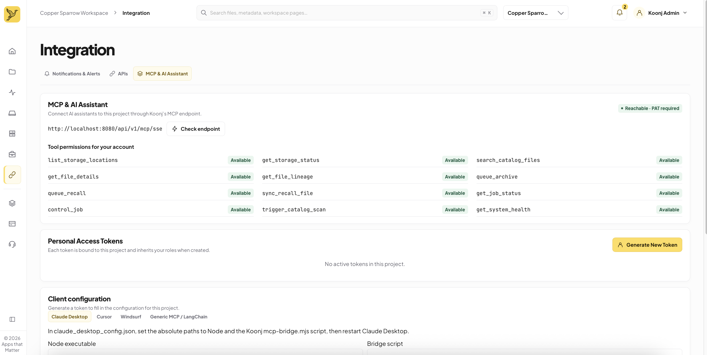

Koonj's Model Context Protocol (MCP) server lets a compatible client browse storage, inspect file history, and request operations allowed by your project permissions. It uses the MCP `2024-11-05` HTTP transport with Server-Sent Events (SSE).

## Generate a project token

1. Select the project you want the client to access.
2. Open **Integration → MCP & AI Assistant → Generate New Token**.
3. Name the token, set an expiration, and copy it when it appears. Koonj shows the secret once.
4. Use **Test connection** to verify the token and inspect the available tools.

<Frame caption="The MCP tab shows endpoint status, tool permissions, and client configuration.">
  
</Frame>

## Configure the client

Use the example under **Client configuration** for Claude Desktop, Cursor, Windsurf, or a custom MCP client. Use the HTTPS origin of your Koonj deployment. The SSE endpoint is `/api/v1/mcp/sse`. The stream announces the session-specific message endpoint. Send `Authorization: Bearer <PAT>` with the stream request and message requests.

The project is part of the token. If your client sends `X-Koonj-Project`, use the same project ID. Keep the token in a private configuration or secret store and revoke it in **Personal Access Tokens** when you no longer need it. After an identity-provider role change, revoke existing tokens and issue replacements.

## Configure a reverse proxy

The packaged Docker proxy includes MCP routes. With a custom proxy, disable buffering, caching, and compression for the SSE route. Route `/api/v1/mcp/sse` and `/api/v1/mcp/message` to the same API instance so they share session state. Keep tokens out of proxy and application logs. For clients that pass a token in the SSE URL, redact the query string.
