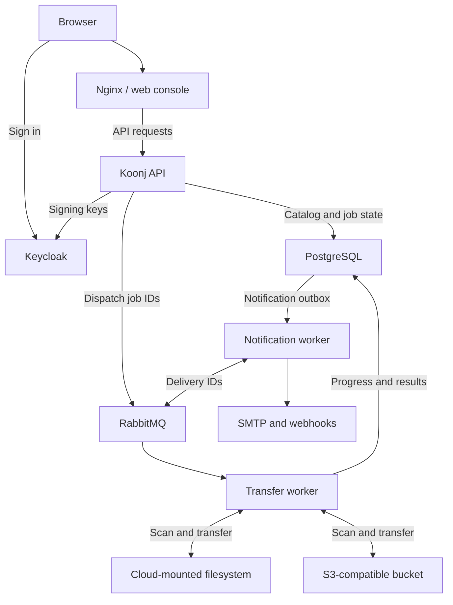
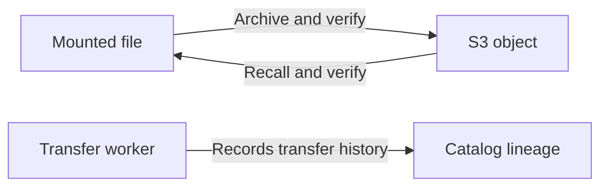

The console is where you find files and request work. A scan records file information in the catalog. Archive and recall jobs move file contents between a mounted directory and an S3-compatible bucket.

## Cloud deployment

| Component | Responsibility |
| --- | --- |
| Koonj API | Checks permissions and project membership, manages storage connections, and accepts jobs. |
| PostgreSQL | Stores catalog metadata, permissions, job state, path reservations, and notification events. |
| RabbitMQ | Dispatches transfer jobs and notification deliveries. |
| Transfer worker | Reads and writes files, verifies checksums, and records progress and results. |
| Notification worker | Delivers email and webhooks, including Slack and Microsoft Teams channels. |

## Archive and recall

When you submit a transfer, the API reserves the selected paths in PostgreSQL. Overlapping work can be rejected while those reservations are active. RabbitMQ sends the job ID to an eligible worker, which transfers the data directly between storage locations and records the outcome. With **Copy**, archiving retains the original. With **Purge**, Koonj replaces the verified source file with an archive link.

An optional [transparent recall gateway](/installation/recall-gateway) can request a restore when a client opens an archive link. Some S3 storage classes require the provider to restore the object before the worker can read it.

See [Deployment configuration](/installation/configuration) for identity, worker routing, and storage authentication.
