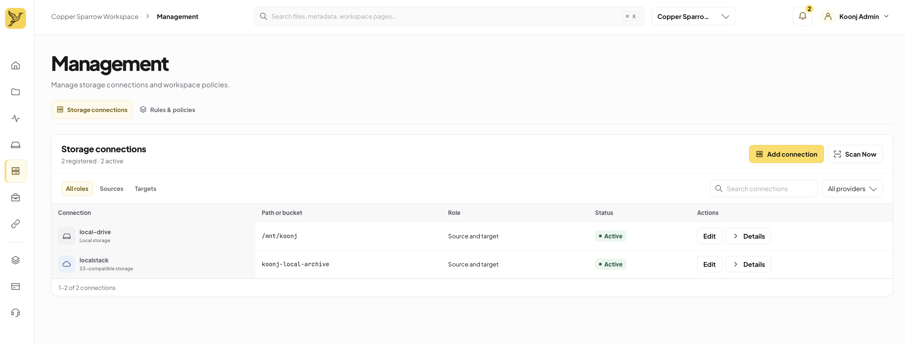

## Manage projects and permissions

Use **Projects** to create a project or invite teammates. To send an invitation, select an enabled email channel, enter the recipient's email address, and click **Invite by email**. Check **Pending invitations** for its status. Project membership gives users access according to their role permissions. Use dedicated mount roots, buckets, or prefixes to separate storage across projects.

Assign realm roles in Keycloak. In Koonj, use **Administration → Permissions** to change the Operator and Viewer defaults across projects. Koonj combines grants from all roles assigned to an account. Administrator permissions are fixed.

| Realm role | Default access |
| --- | --- |
| `KOONJ_ADMIN` | Full permissions, including project and storage administration, job controls, and purge. |
| `KOONJ_OPERATOR` | Catalog, scan, archive in Copy mode, recall, Activity log and job controls, and Storage status. |
| `KOONJ_VIEWER` | Home and read-only Catalog access. |

## Storage connections

Open **Management → Storage connections → Add connection**. Enter the name, provider, storage path or bucket, and role. A **Source** can supply files, a **Target** can receive them, and **Both** permits either use when supported by the provider and transfer direction. Use **Test Connection** and **Save connection**.

| Provider | Connection fields |
| --- | --- |
| Mounted filesystem | Mount the directory on the cloud host. In packaged Docker, enter the container path under `/mnt/koonj`. The API and transfer workers need access. |
| AWS S3 | Enter the existing bucket and AWS region. Leave custom endpoint blank and disable path-style access for standard AWS endpoints. Choose the authentication method your deployment supports. |
| MinIO, RustFS, Scality, or custom S3 | Enter the existing bucket, HTTPS endpoint, region, and a supported authentication method. Enable path-style access when required by your provider. |

<Frame caption="Management shows each storage connection, its role, and whether it is active.">
  
</Frame>

See [storage authentication](/installation/configuration#choose-storage-authentication) for AWS roles and credential options.

Use **Scan Now** to queue scans for eligible source connections. Open **Management → Rules & policies → File temperature** to set project thresholds for hot, warm, and cold files. These thresholds classify files in the catalog. Run transfers from the catalog.

## Configure notifications and alerts

Open **Integration → Notifications & Alerts**. Create and test an SMTP, webhook, Slack, or Teams channel. Attach channels to enabled rules and check delivery history for outcomes and retries. These settings apply across the installation.

- Use batch and failure rules to alert on transfer completion or failures at configured thresholds.
- Use quota and license rules with the limits and dates configured on the server.
- Job email goes to the initiating user's verified sign-in address recorded when the job starts. Delivery also checks current email preferences.
- Generic webhooks receive JSON. If you configure a signing secret, verify `X-Koonj-Signature` by comparing the value after `sha256=` to the hex HMAC-SHA256 of the exact request body. Use the stable `deliveryId` to identify retries.

For the broker and worker configuration, see [Operate and upgrade Koonj](/installation/operations#run-the-notification-worker).
