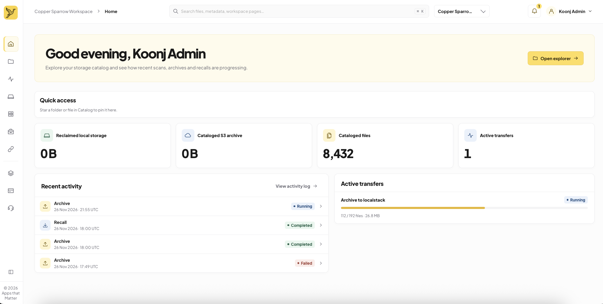

Koonj is an open-source data catalog and archival platform. Use it to see what files you have, copy them to object storage, and bring them back when you need them. Each project has its own catalog, storage connections, and transfer jobs.

<Columns cols={2}>
  <Card title="Archive your first file" icon="rocket" href="/quickstart">
    Scan a test directory, copy a file to S3, and verify its recall.
  </Card>
  <Card title="Use the console" icon="book-open" href="/guides/user">
    Browse files, inspect their history, and track jobs.
  </Card>
  <Card title="Deploy to the cloud" icon="cloud" href="/installation/docker">
    Install the packaged Docker Compose stack on a cloud host.
  </Card>
  <Card title="Explore the architecture" icon="diagram-project" href="/architecture">
    See how authentication, storage, and background jobs fit together.
  </Card>
</Columns>

<Frame caption="Home shows recent jobs, active transfers, and your starred files.">
  
</Frame>

Project administrators can [manage access and storage](/guides/administration). Developers can automate workflows through the [REST API](/api/overview) or connect an [MCP client](/api/mcp).
