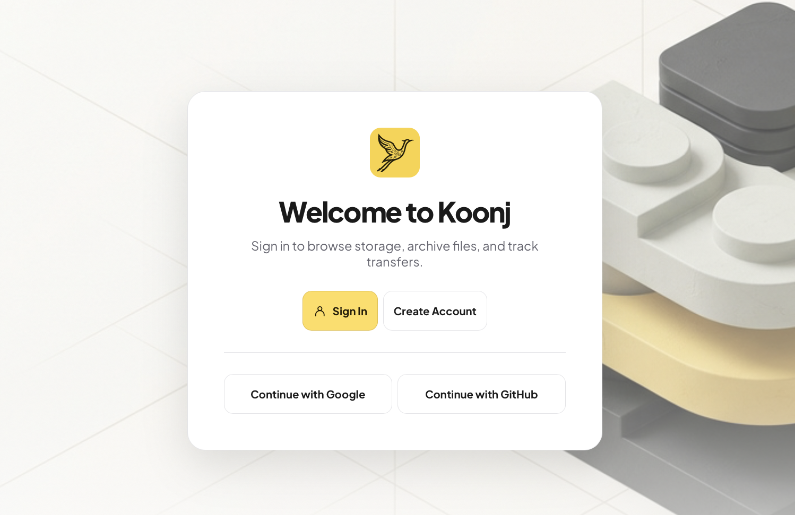

You need a Koonj console URL, a project where you can scan and run transfers, a writable test directory mounted on the cloud host, and a writable S3-compatible test bucket. Ask a project administrator to [add both storage connections](/guides/administration#storage-connections) with the **Both** role. If you operate the deployment, start with [Install with Docker](/installation/docker).

<Frame caption="Sign in with the method configured for your workspace.">
  
</Frame>

<Steps>
  <Step title="Find your test file">
    Put a small disposable file, such as `report.txt`, in the test directory. Sign in, select your project, and open **Catalog**. Select the mounted test location and click **Scan**. Once the scan finishes in **Activity log**, return to **Catalog** and find the file.
  </Step>
  <Step title="Copy it to the archive">
    Select the file and click **Archive to S3**. Choose the test bucket, **Copy**, and the `STANDARD` storage class. Click **Submit archive**. In **Activity log**, open the job and confirm that the file was copied. **Copy** leaves the source file in place.
  </Step>
  <Step title="Recall and verify the file">
    Select the archived file in **Catalog** and click **Recall to Source**. Choose the test destination and check the path. Recall can replace the file at that path. Leave **Remove the S3 copy after restoring** unchecked. Submit the job, confirm it completed in **Activity log**, and compare the restored contents with the original.
  </Step>
</Steps>

[Explore the console guide](/guides/user) for transfer history, checksums, and what to do when a job fails.
